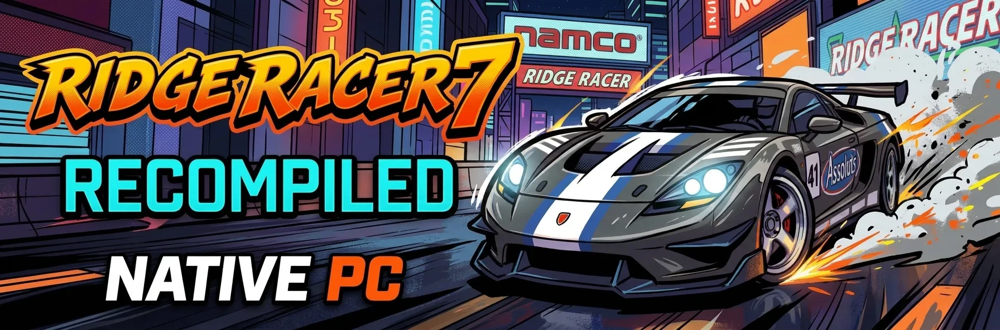



  

# Max Racer 7

🇬🇧 [English](README.md) · 🇪🇸 **Español**

Port nativo a PC (Windows) del juego de carreras de PS3 **Ridge Racer 7**,
hecho por recompilación estática del ejecutable con un runtime C/C++ propio
(basado en [ps3recomp](https://github.com/sp00nznet/ps3recomp)). No es un
emulador: el código del juego se traduce a código nativo x86-64 y el render
va por DirectX 12.

> **Versión v0.0.4 — fase temprana de desarrollo (alfa).**
> Arranca, reproduce los vídeos y llega a menús y carreras, pero hay fallos
> gráficos, de vídeo y de velocidad. Todavía no es jugable de principio a fin.

## ❤️ Apoya el proyecto

Si quieres que el port siga avanzando con nuevas actualizaciones, puedes
apoyarlo en Patreon:

**👉 [patreon.com/cw/ilesraider](https://www.patreon.com/cw/ilesraider/membership)**

## Descarga

Descarga el zip de la última versión en
[Releases](https://github.com/kensaiken/max-racer-7/releases).

**El paquete no incluye el juego.** Necesitas tu propia copia original
(disco europeo **BCES00009**).

## Instalación

Guía completa: [INSTALACION.md](INSTALACION.md). Resumen:

1. Instala el [Visual C++ Redistributable x64](https://aka.ms/vs/17/release/vc_redist.x64.exe).
2. Descomprime `MaxRacer7-v0.0.4.zip` en una carpeta.
3. Copia el **EBOOT.elf descifrado** de tu disco a `game\EBOOT.elf`
   (con RPCS3: *Utilities → Decrypt PS3 Binaries* sobre `PS3_GAME\USRDIR\EBOOT.BIN`).
4. Ejecuta `Iniciar.bat` e indica tu ISO o la carpeta del disco:
   `Iniciar.bat -Disco "D:\Juegos\RR7.iso"`

## Estado (v0.0.4)

| Área | Estado |
|---|---|
| Ejecución del código del juego (PPU + SPU) | OK |
| Carga de datos y streaming desde el disco | OK |
| Vídeos (MPEG-2 vía FFmpeg) | OK, con algún fallo ocasional |
| Menús y HUD | OK |
| Carreras en 3D | Funcionan, con fallos gráficos |
| Velocidad | ~60 fps en casi toda la carrera, ~46 en los tramos más pesados |
| Nitro | Pantalla incorrecta al activarlo |
| Audio | OK |

## Requisitos

- Windows 10/11 64 bits
- GPU con DirectX 12
- Mando XInput recomendado (también funciona con teclado, ver `LEEME.txt`)

## Reportar fallos

Abre un [issue](https://github.com/kensaiken/max-racer-7/issues) con una
descripción, tu GPU y el archivo `log_err.txt` que se crea junto al ejecutable.

## Documentos técnicos

- `INFORME_FASE4A.md` — bitácora técnica completa.
- `ESTADO.md` — estado y pendientes.
- `INFORME_FASE1.md`, `PLAN_FASE2.md`, `FORMATOS.md`, `COMPILACION.md`, `DEPURACION.md`, `LEGAL.md`.

## Aviso legal

Proyecto no oficial, sin afiliación con Bandai Namco ni Sony. Ni el
repositorio ni las descargas incluyen el EBOOT original, datos, texturas,
música, vídeos, claves ni firmware: todo eso sale de la copia del propio
usuario. "Ridge Racer" es marca de Bandai Namco; "PlayStation" es marca de
Sony Interactive Entertainment. Más detalles en [LEGAL.md](LEGAL.md).
