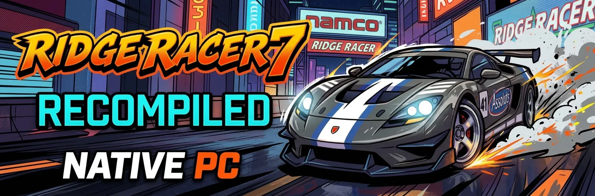

  

# Max Racer 7

🇬🇧 **English** · 🇪🇸 [Español](README.es.md)

A native PC (Windows) port of the PS3 racing game **Ridge Racer 7**, built by
statically recompiling the game's executable on top of a custom C/C++ runtime
(based on [ps3recomp](https://github.com/sp00nznet/ps3recomp)). It is not an
emulator: the game code is translated to native x86-64 code and rendering goes
through DirectX 12.

> **Version v0.0.2 — early development stage (alpha).**
> It boots, plays the videos and reaches the menus and races, but there are
> graphical, video and performance issues. It is not yet playable from start
> to finish.

## ❤️ Support the project

If you want the port to keep moving forward with new updates, you can support
it on Patreon:

**👉 [patreon.com/cw/ilesraider](https://www.patreon.com/cw/ilesraider/membership)**

## Download

Get the latest zip from
[Releases](https://github.com/kensaiken/max-racer-7/releases).

**The package does not include the game.** You need your own original copy
(European disc **BCES00009**).

## Installation

Full guide: [INSTALL.md](INSTALL.md). Quick version:

1. Install the [Visual C++ Redistributable x64](https://aka.ms/vs/17/release/vc_redist.x64.exe).
2. Extract `MaxRacer7-v0.0.2.zip` to a folder.
3. Copy the **decrypted EBOOT.elf** from your disc to `game\EBOOT.elf`
   (with RPCS3: *Utilities → Decrypt PS3 Binaries* on `PS3_GAME\USRDIR\EBOOT.BIN`).
4. Run `Iniciar.bat` and point it at your ISO or disc folder:
   `Iniciar.bat -Disco "D:\Games\RR7.iso"`

## Status (v0.0.2)

| Area | Status |
|---|---|
| Game code execution (PPU + SPU) | OK |
| Loading and streaming data from disc | OK |
| Videos (MPEG-2 via FFmpeg) | OK, occasional glitches |
| Menus and HUD | OK |
| 3D races | Working, with graphical glitches |
| Performance | Low: races run in slow motion |
| Nitro | Wrong screen when activated |
| Audio | Partial |

## Requirements

- Windows 10/11 64-bit
- DirectX 12 capable GPU
- XInput controller recommended (keyboard works too, see [INSTALL.md](INSTALL.md#controls))

## Reporting bugs

Open an [issue](https://github.com/kensaiken/max-racer-7/issues) with a
description, your GPU and the `log_err.txt` file created next to the
executable.

## Technical documents (Spanish)

- `INFORME_FASE4A.md` — full technical log.
- `ESTADO.md` — status and to-do.
- `INFORME_FASE1.md`, `PLAN_FASE2.md`, `FORMATOS.md`, `COMPILACION.md`, `DEPURACION.md`, `LEGAL.md`.

## Legal notice

Unofficial project, not affiliated with Bandai Namco or Sony. Neither this
repository nor the downloads include the original EBOOT, game data, textures,
music, videos, keys or firmware: all of that comes from the user's own copy.
"Ridge Racer" is a trademark of Bandai Namco; "PlayStation" is a trademark of
Sony Interactive Entertainment. More details in [LEGAL.md](LEGAL.md) (Spanish).
